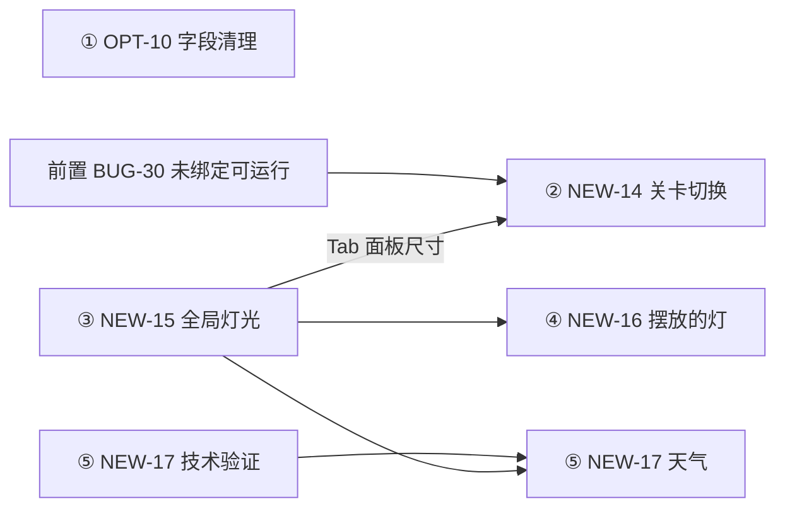

# OntoTwin 4.7 场景演出：关卡切换 · 环境灯光 · 摆放的灯 · 天气（PRD）

> 版本：4.7（大功能，新立）
> 文档性质：产品需求与技术方案
> 日期：2026-11-26（第 2 版：已吸收代码评审意见，见第 8 节）
> 状态：需求已和产品逐项确认，**未开发**
> 本文编号：NEW-14、NEW-15、NEW-16、NEW-17。每条开工时按 AGENTS.md 登记台账、建 `.worktrees/<编号>` 草稿
> 前置版本：3.4.3 分区目录与新建交互、3.5.3 Runtime Editor 模型库与运行时放置、3.8.2 业务配置与运行交互重构、4.0 场景交互层与人物漫游、4.5 语义表现路由层
> 最终目标：非开发人员通过 OntoTwin 网页 + UE 运行时，自己搭建场景、赋予功能
> 总原则：**尽量改造现有功能，少引入新概念。** 这一轮新增给使用者的概念只有"环境"和"摆放的灯"两个

---

## 0. 总览

### 0.1 本轮全部修改的编号与顺序

按"大功能新立 PRD、小功能写补充、缺陷单独记录"的原则，这一轮的 6 条修改分在 4 份文档里：

| 序号 | 编号 | 名称 | 性质 | 文档 | 依赖 |
|---|---|---|---|---|---|
| ① | **OPT-10** | 三处 UE 关卡字段清理 | 小功能补充 | `PRD/OntoTwin 3.4.3.1 UE 关卡字段清理补丁 (PRD).md` | 无 |
| 前置 | **BUG-30** | 未绑定的关卡也能正常运行 | 缺陷 | `IMPLEMENTATION/4.8/BUG-30 未绑定关卡卡在加载画面.md` | 无 |
| ② | **NEW-14** | 关卡切换 | 大功能（本文第 1 节） | 本文 | BUG-30；Tab 面板尺寸由 NEW-15 先定 |
| ③ | **NEW-15** | 环境 · 全局灯光 | 大功能（本文第 2 节） | 本文 | 无 |
| ④ | **NEW-16** | 摆放的灯 | 大功能（本文第 3 节） | 本文 | NEW-15 |
| ⑤ | **NEW-17** | 环境 · 天气 | 大功能（本文第 4 节） | 本文 | 产品购买插件；接进 NEW-15 的光照合成 |

推进顺序：① 和 ③ 先并行开工 → BUG-30 完成后做 ② → ③ 完成后做 ④ → ⑤ 的技术验证在产品买好插件后即可开始。



### 0.2 同一轮讨论中拆出的其他修改（不在本文范围）

| 编号 | 名称 | 性质 | 文档 | 和本文的关系 |
|---|---|---|---|---|
| BUG-31 | 运行时 Tab 面板跳转区域偶尔不生效 | 缺陷 | `IMPLEMENTATION/4.8/BUG-31 运行时区域跳转偶尔不生效.md` | 本文把"区域跳转"定为关卡内跳到某个地方的正式方案，要先修稳 |
| OPT-11 | 业务视图镜头取景校准 | 小功能补充 | `PRD/OntoTwin 3.8.3 业务视图镜头取景校准补丁 (PRD).md` | 以后的"机位"概念要和它的方案 B 一起设计 |

### 0.3 共用的技术做法（开发必读）

**配置存放与版本**

- 全部放进每个数据集现有的 `scene_interactions`（PostgreSQL `project` 表的 JSONB 列）下的新键，**不改数据库结构**：`scene_interactions.level_switch`、`scene_interactions.environment`。
- **每个新键自带独立的 `revision`**，保存时只检查自己这个键的版本，**不使用也不改动** `scene_interactions.revision`。否则一个页面改漫游路线、另一个页面调灯光会互相报 409 冲突。
- 每个新键都有自己的校验函数，拒绝未知字段、超出范围的值、非有限数（NaN）、用布尔值冒充数字、不在选项里的值。
- **写当前打开的数据集**：沿用 `store.transact_expected_active`。**写别的数据集**（只有 NEW-14 配置页需要）：见 1.6 节。

**下发和回报**

- 下发：在 `scene_interaction/runtime_projection.py` 的 `build_runtime_projection` 里加上 `level_switch`、`environment`（各带自己的 revision）。UE 端由 `UTwinInteractionManagerComponent` 每秒拉取 `/api/v2/scene-interactions/runtime`，网页改完约 1 秒生效。
- UE 判断"网页设定变了"时，**只比较 `environment.lighting`、`environment.weather` 各自的内容**，不看总版本号。否则网页改一条漫游路线，就会把 UE 里的临时夜晚冲掉。
- 回报：UE 每 2 秒的心跳（POST `/api/v2/scene-interactions/runtime`）里加上"实际生效了什么"。现在 `scene_interaction/service.py` 的 `RuntimeStatusRegistry` 是"每个数据集一格、后到的覆盖先到的"，改为**按每台 UE 分别记录**，网页显示汇总，如"2 台 UE 在线，其中 1 台临时切到了夜晚"（产品决定 2026-11-26：会出现两台电脑同时运行同一个程序的情况）。
  - **UE 现在没有上报"我是哪一台"**。新增请求头 `X-OntoTwin-UE-Run-Id`：UE 程序每次启动生成一个随机编号，存在 `UGameInstanceSubsystem` 里，换关卡不变，所有请求都带上。后台按"数据集 + 运行编号"记录，超过 10 秒没心跳的那台从汇总里去掉。
  - 老版本 UE 不带这个请求头时，按"未知的一台"处理（和现在一样一格覆盖），不报错。
  - 4.8 后台里有一套"一个关卡只许一个连接"的认领接口（`tenant_api.py` 的 `/api/v4.8/ue/connections`），UE 插件没有使用，本文**不启用也不改动**它。
- 网页上**只存"要求的值"**，不把 UE 回报的值写回配置。

**未绑定的关卡**

- 未绑定时，`scene_interaction/api.py` 对 `/runtime` 直接返回 403 `ue_project_unbound`。UE 在未绑定时应**停发** `/runtime` 的轮询和心跳（和 BUG-30 一起处理），绑定后再恢复。
- 不依赖后台的功能在本地照常工作：关卡切换、全局灯光的"关卡原样"、Tab 面板里的临时切换。

**代码组织**

- 后台新代码放独立模块 `01-source/backend/scene_presentation/`（api、service、validators、tests），不往 `app.py` 里加。
- UE 新代码放独立目录 `OntoTwinSync/Source/OntoTwinSync/{Private,Public}/ScenePresentation/`。不依赖各项目自己的 GameInstance，跨关卡的状态用 `UGameInstanceSubsystem`。
- **网页外壳有三处要改**：正式入口 `/nexus` 实际返回的是 `frontend/nexus48.html`（`app.py` L382），旧版 `frontend/nexus.html` 走 `/nexus-legacy`，两处菜单都要加；`frontend/interaction.html` L944 的分页白名单写死了 `['roaming','routes','web']`，要加上 `levels`、`environment`。
- **运行时才按路径加载的 UE 素材**（加载画面底图、灯光图标、方案参数、工程设置里勾选的地图和预览图）都要登记进打包清单（参照行为库手册第 3 节、NEW-05 的 `GetModifyCookDelegate`）。软引用不会让 UE 自动把东西打进包里。
- **新增引擎模块依赖**：`MoviePlayer`（UE 自带的加载画面模块），产品已同意（2026-11-26）。加到 `OntoTwinSync.Build.cs`。
- **日志**：每次执行写一行，格式参照 `[OT-Presentation]`，分别用 `[OT-LevelSwitch]`、`[OT-Environment]`、`[OT-PlacedLight]`、`[OT-Weather]`。

**Tab 面板尺寸（NEW-14、NEW-15 共用，必须先定）**

`OntoTwinRuntimeDockWidget.cpp` L42 把内容区高度写死为 `ContentHeight = 110`，每行约 44。「空间」页签已经用了约 96，再加一行关卡下拉框会溢出；「环境」页签也放不下。**由先开工的 NEW-15 负责**把内容区改成"按页签内容自适应高度（设上限，超出滚动）"，并在台账备注里写明新的尺寸规则；NEW-14 在它的基础上加控件。两条的草稿合并时，按 AGENTS.md "调整自己的去适应先发布的那一条"。

**平台定位与验收**

- 主要目标是 **Windows + RTX 5090**（可以用 Lumen、MegaLights）。Linux + Vulkan SM5 只要求能跑，效果可以降级（例如转场退回黑场）。
- 只改 UE 的部分在 5501 上看不出来，按 AGENTS.md 换成产品能看到的方式验收（打包好的 UE 程序或录屏）；网页部分用 `python 01-source/tools/publish_5501.py --task <编号>` 发布到 5501。

---

## 1. ② NEW-14 关卡切换

### 1.1 已定的决定
| # | 决定 |
|---|---|
| D9 | 关卡切换 = 换地图 = 换数据集。参照 NEW-06 的做法，改成平台通用能力。NEW-06 本身只算项目交付，暂不进 dev |
| D12 | 入口放在 UE 运行时 Tab 面板的「空间」页签，作为最上面一级（关卡 → 楼栋 → 楼层 → 房间） |
| D14 | 可切换的关卡由美术在 UE 工程设置里勾选，并填写显示名称和预览图 |
| D15 | 未绑定数据集的关卡**允许进入**（依赖 BUG-30） |
| D16 | 启动时进入 UE 工程设定的默认地图，平台不另加启动选择页 |
| D17 | 实现 3 种转场：黑场、封面加载页、画面溶解；另外 3 种（过场视频、镜头俯冲、特效过渡）在网页上列出，显示为"待补充素材"，选不了 |
| D18、D19 | 网页上单独做「关卡切换」配置页；转场挂在**目标关卡**上，表示"进入这个关卡时用什么转场"，存在它绑定的数据集里；未绑定的关卡固定用黑场 |
| D20 | 浏览器里的 OntoTwin 网页**不**跟着 UE 切换数据集 |
| D21 | 配置页放在左侧菜单「场景交互」组，列出同一个 UE 程序里所有已绑定数据集的关卡 |
| D31 | 引入 UE 自带的 MoviePlayer 模块，加载期间画面不冻住（2026-11-26） |
| D33 | 配置页一次保存多个数据集：**每行单独保存**，成功的行生效，冲突的行标红提示"已被他人修改，请刷新"（2026-11-26） |
| D34 | 画面溶解：**等第一批设备加载完再溶解，最多等 5 秒**；等待期间停在旧画面上，叠一个小进度提示（2026-11-26） |
| — | 关卡内跳到某个地方：用现有的「区域 + Tab 面板跳转」（先修好 BUG-31）。本轮不做子关卡、机位 |

### 1.2 UE 工程设置（美术配置）
新增一个工程设置页「OntoTwin 关卡切换」（`UDeveloperSettings`，存在工程的 ini 里），内容是一个列表，每行包括：

| 字段 | 说明 |
|---|---|
| 地图 | 选一张地图（软引用） |
| 场景编号 | 可选。留空时自动用地图包路径。地图里的 `ATwinSceneManager::SceneId` 只有地图加载后才读得到，所以**没加载的目标地图的场景编号只能从这里取** |
| 显示名称 | 中文名，例如"标准厂房" |
| 预览图 | 一张贴图，用于封面加载页；可留空 |
| 排序 | 在下拉框里的顺序 |

- 运行时 `EnsureSceneId()`（`TwinSceneManager.cpp` 约 L223）改为：关卡里手动指定的 `SceneId` → 本表里当前地图的"场景编号" → 地图包路径，按这个顺序取第一个非空值。关卡里手填的值和本表不一致时，写一条警告日志。
- 本表里所有地图和预览图都要登记进打包清单（见 0.3）。
- 列表为空时，「空间」页签里**不显示**关卡下拉框，和现在完全一样。没配置的已上线项目升级后看不到任何变化。

### 1.3 Tab 面板「空间」页签
```
当前位置：标准厂房 / 2楼 / 会议室
关卡    [标准厂房 ▾]        ← 新增，最上面一级
目标位置 [楼栋 ▾][楼层 ▾][房间 ▾]
                     [前往位置]
```
- 下拉框每一项显示：显示名称 + 绑定状态（"数据集：xx" / "未绑定"）。
- **绑定状态用新的只读批量接口查询**：`POST /api/v2/scene-presentation/level-statuses`。
  - 请求头照常带 UE **当前真实所在**关卡的身份；请求体传候选的场景编号列表。
  - 返回每个场景的绑定状态、数据集名称、进场转场配置（来自目标数据集的 `level_switch`）。
  - 这个接口**不能**调用 `observe_ue_project`，不能改动"UE 当前在哪张地图"的记录。
  - 原因：现有的 `/api/v2/ue/binding_status` 会经过 `resolve_project_for_ue` → `observe_ue_project`（`ue_project_binding.py` L344、L107-130），按 UE 工程只留一格、后到覆盖先到。拿它去查别的关卡，会让网页的"UE 在线"绿点和绑定弹窗误以为 UE 已经切走了。
- 打开下拉框时查询一次；查询失败时，列表照样显示，状态显示"状态未知"，仍允许切换。

### 1.4 切换流程
1. 在下拉框里选一个别的关卡 → 弹出确认框："切换到『xx』会重新加载场景，需要几秒钟。"[切换] [取消]。
2. **F10 和业务配置有未完成的状态时**，确认框改为 [保存后切换] [放弃修改并切换] [继续编辑]。要检查的状态：
   - `IsRuntimeEditDirty`（有未保存的修改）、`IsRuntimeEditSaving`（正在保存）；
   - `bPlacementSending`（正在提交放置，`TwinSceneManagerPlacement.cpp`）；
   - `bRuntimeBusinessDirty`（业务配置未保存，`TwinSceneManager.h` L713）。
   
   正在保存或正在提交放置时，提示"正在保存，请稍后切换"，不允许切换。逻辑参照 NEW-06 `StandardSceneGameInstance.cpp` 的 `Enter`、`WaitForSave`。
3. **先确认目标地图在程序里**：用 `FPackageName::DoesPackageExist` 预检。不存在就提示"无法进入『xx』：程序里没有这张地图"，**不播转场，也不调用 `OpenLevel`**。原因：`OpenLevel` 一旦调用，地图不存在时引擎会卸掉当前关卡或退回默认地图，不会"留在原关卡"。
4. 正在 F7 漫游 → 先 `ExitRoaming()`。
5. 收起 Tab 面板、网页面板等界面 → 按目标关卡配置的转场执行（见 1.5）→ `UGameplayStatics::OpenLevel`。
6. 新地图加载完 → 按转场规则收尾；之后显示的设备加载进度，和转场的遮罩不能叠在一起打架（见 1.5）。
7. 选的就是当前关卡 → 什么都不做。

### 1.5 转场

**共同规则**

- **遮罩用最高层级的全屏界面**，不能只用 `PlayerCameraManager::StartCameraFade`：后者只把三维画面变黑，Tab 面板、小地图、网页弹窗和"正在加载数据模型"卡片（`OntoTwinModelLoadingWidget`）都会亮着浮在黑屏上。
- 换地图期间用 MoviePlayer（`GetMoviePlayer()->SetupLoadingScreen`）显示加载画面。**注意：编辑器里直接运行（PIE）时 MoviePlayer 不生效**，自测封面加载页和画面溶解必须用独立运行（Standalone）或打包版。
- 遵守现有的"减少动态"设置（`FOntoTwinGlassRenderer::ShouldReduceMotion` 为真时，时长按 0 处理）。
- UE 端的转场做成可扩展的注册表，以后加新方式不用改架构。

| 方式 | 效果 | 参数 | 实现要点 |
|---|---|---|---|
| 黑场 | 全屏遮罩渐暗 → 黑屏加载 → 新地图开始后渐亮 | 时长 0.2–3 秒，默认 0.5 | 加载期间 MoviePlayer 显示纯黑 |
| 封面加载页 | 渐暗 → 全屏显示目标关卡的预览图 + 名称（+ 进度或转圈）→ 第一批设备加载完（最多等 5 秒）后渐亮 | 时长；是否显示进度 | 预览图来自 1.2 的工程设置，没配时用平台默认底图。新地图里的设备加载卡片在封面消失前不单独显示，进度并入封面 |
| 画面溶解 | 截下旧关卡最后一帧 → 加载期间显示这张截图（叠小进度提示）→ 新地图第一批设备加载完（最多等 5 秒）后，旧画面淡出 | 时长 | 截图跨关卡保存在 `UGameInstanceSubsystem` 里。换地图时引擎会强制做一次全量垃圾回收：截图要么存成原始像素数组配合 `FSlateDynamicImageBrush`，要么用 `UPROPERTY()` 强引用 `UTexture2D`，否则切地图的瞬间会崩溃。未绑定的目标关卡没有设备可等，地图加载完就开始淡出 |
| 过场视频 / 镜头俯冲 / 特效过渡 | — | — | 网页上列出、显示为灰色"待补充素材" |

### 1.6 网页「关卡切换」配置页
- 菜单：`nexus48.html` 和 `nexus.html` 的「场景交互」组都加「关卡切换」，排在「人物漫游」前面；页面放在 `interaction.html?feature=levels`。
- 内容：列出**当前数据集所绑定的 UE 程序**里所有已绑定数据集的关卡。
```
关卡切换配置 · UE 程序：OntoTwinStandardScenes
关卡        绑定的数据集        进入时的转场        时长   进度
标准厂房 ★   标准厂房示例        [封面加载页 ▾]     1.0s   [开]
展示空间     展厅示例           [画面溶解 ▾]       1.5s
空白场地     某某（无权限）      画面溶解（只读）
[应用到全部]                                        [保存]
未绑定数据集的关卡进入时固定使用黑场，不在此列出。
```
- **当前数据集还没绑定任何 UE 关卡时**：页面只显示"当前数据集尚未绑定 UE 关卡，绑定后才能配置关卡切换"，并给出去绑定的入口。
- 权限与隔离：用户有权编辑的数据集才能改，没权限的行只读，"应用到全部"只作用于可编辑的行；其他组织的数据集**不显示**。
- 存放：每个数据集 `scene_interactions.level_switch = {revision, transition: {mode, duration_s, show_progress}}`。`mode` 可选 `fade` / `cover` / `dissolve`；`video` / `camera_dive` / `fx` 保留，校验时拒绝。
- **跨数据集写入**：4.8 的请求守卫（`app.py`、`scoped_project_store.py`）把每次请求锁死在当前打开的数据集上，对其他数据集调 `transact_expected_active` 会抛 `ProjectMismatch`（409）。所以这个接口要：
  - 用底层的 `store.base.transact_project(target_pid, …)` 逐行写入；
  - **逐行**在后台单独校验：用户对 `target_pid` 有编辑权限、`target_pid` 和当前数据集属于同一组织、确实绑定在同一个 UE 程序上；
  - 每行按各自的 `level_switch.revision` 做并发检查；
  - 返回逐行结果（成功 / 冲突 / 无权限），前端标红冲突和无权限的行（D33）。

### 1.7 验收清单
- [ ] 工程设置里配 3 张地图（其中一张填了自定义场景编号），「空间」页签出现关卡下拉框，显示名称和绑定状态正确；不配时不出现，界面和现在完全一样。
- [ ] 在关卡 A 打开下拉框以后，网页上"UE 在线"和绑定弹窗里显示的仍然是关卡 A。
- [ ] 三种转场各切换一次（用打包版或独立运行），效果和网页上的配置一致；黑场期间看不到任何界面浮在上面；修改网页配置后，下一次切换立刻按新配置执行。
- [ ] 画面溶解：等设备加载完才淡出，最多等 5 秒；未绑定的目标关卡也能正常淡出。
- [ ] F10 有未保存的修改、正在保存、正在提交放置、业务配置未保存时，行为都正确；漫游中切换会先退出漫游。
- [ ] 进入未绑定的关卡：不卡加载画面，有"尚未绑定"提示（依赖 BUG-30）；在网页上绑定后自动接上。
- [ ] 同一个程序里，在 A、B、C 之间往返切换 9 次，每次设备都正确（对齐标准工程 PRD 的 AC-07），程序不崩溃。
- [ ] 目标地图不在程序里：提示后留在原关卡，没有转场，没有黑屏。
- [ ] 网页配置页：权限、只读、"应用到全部"、组织隔离、逐行冲突提示、当前数据集未绑定时的空状态都正确；后台测试覆盖校验、跨数据集权限和并发冲突。
- [ ] 不装天气插件的工程里也全部通过。

---

## 2. ③ NEW-15 环境 · 全局灯光

### 2.1 已定的决定
| # | 决定 |
|---|---|
| D3 | 灯光是**全局**能力，和业务视图无关 |
| D4（修订） | 方案 = **关卡原样**（美术调的那一套，默认）+ 平台自带 4 个：白天、黄昏、夜晚、展示 |
| D22 | 网页上设定，UE 实时生效；UE 里可以临时切换，**不保存**（重启或网页上的设定一变就回到网页的值） |
| D23 | 给使用者开放 3 个参数：整体亮度、色温、阴影开关。**不开放**太阳角度、时间、雾浓度、天空颜色（方案内部可以改太阳角度和天空，只是不让使用者调） |
| D24 | 接管关卡原有的环境光，在它们的参数上修改；关卡原样随时能切回，原值不丢 |
| D28 | UE 端在 Tab 面板新增「环境」页签（全局灯光 + 天气）；网页上的页面叫「环境」 |
| D35 | 多台 UE 同时在线时，网页显示汇总（见 0.3） |
| — | 灯光方案不含"阴天"（天气里有"阴"）；没有时间概念，跟随真实时间属于路线图 |

### 2.2 单一光照合成管线（NEW-15、NEW-17 共同遵守）
**只有 `UOntoTwinEnvironmentComponent` 能写关卡的太阳、天光、天空、雾和曝光。** 天气插件不直接改这些对象，只负责雨雪粒子、云层等自己的东西，并把"天气光影修正"交给环境组件（见 4.3）。环境组件每次按下面的顺序**一次性**算出最终值：

```
关卡原样快照 → 灯光方案 → 3 个参数（亮度、色温、阴影） → 天气修正
```

这样切回"晴 + 关卡原样"时，永远能精确回到原样，不会因为两边恢复的先后顺序而打架。

### 2.3 UE 端
**`UOntoTwinEnvironmentComponent`**（挂在 `ATwinSceneManager` 上）

- **BeginPlay 时记录"关卡原样"**：主太阳（`ADirectionalLight`，优先找作为大气太阳的那一盏）、`ASkyLight`、`ASkyAtmosphere`、`AExponentialHeightFog`、天空球材质参数（如果关卡用的是 HDRI 天空球），存为原样快照。缺哪个就跳过哪个。
- **自带一个后期处理组件**：动态挂一个最高优先级、无边界的 `UPostProcessComponent`，默认关闭；方案或参数偏离原样时开启。"整体亮度"（曝光补偿）和"色温"（白平衡）都通过它叠加，不依赖关卡里有没有全局后期盒，也不受室内局部后期盒、镜头自带曝光设置的影响。
- **方案切换**：按平台方案改上述对象，包括太阳俯仰角和天空。在 UE5 的物理大气下，天空颜色由太阳俯仰角决定，只把太阳调暗的话，"夜晚"头顶还是亮的。如果是 HDRI 天空球，要改天空球材质的参数。**每次切换完成后调用一次 `ASkyLight::RecaptureSky()`**，不能在过渡过程中反复调用（会卡顿）。
- **3 个参数**：
  | 参数 | 存什么 | 范围 | 怎么生效 |
  |---|---|---|---|
  | 整体亮度 | 曝光补偿 | -2.0 到 +2.0，0 为原样 | 自带后期组件的曝光补偿 |
  | 色温 | **无量纲偏移**，不存开尔文绝对值 | -1.0（偏冷）到 +1.0（偏暖），0 为原样 | 自带后期组件的白平衡。不去覆盖灯本身的色温，因为美术的原灯可能没开色温、而是直接调了颜色，覆盖会毁掉原样的色调 |
  | 阴影 | 开 / 关 | — | 主太阳是否投射阴影 |
- **烘焙识别**：主太阳为静态（Static）或固定（Stationary）时，都回报"灯光含烘焙，部分效果不生效"。固定光源的间接光同样烘焙在光照贴图里，切夜晚或关阴影会残留假亮面。
- 改动只作用于自己接管的对象和自己挂的后期组件。

**平台 4 个方案的参数**放在插件里的一个数据资源（Data Asset）里，并登记进打包清单。参数由技术美术在开发阶段调好，产品看效果后确认。

**Tab 面板「环境」页签**（同时负责 Dock 尺寸改造，见 0.3）
```
灯光方案  ( ) 关卡原样  ( ) 白天  ( ) 黄昏  (●) 夜晚  ( ) 展示
          临时：夜晚（网页设定为：关卡原样） [恢复网页设定]
天气      ……（NEW-17）
```
- 只能切方案，不能调参数。
- 临时切换只在本次运行有效；网页上的灯光设定**内容**一变，临时状态立即作废，回到网页的值。
- 未绑定的关卡里也能用：只是没有网页设定可回，[恢复网页设定] 等同于回到关卡原样。

**心跳回报**：当前生效的方案、是否处于临时状态、是否检测到烘焙灯。

### 2.4 网页「环境」页
- 菜单：`nexus48.html` 和 `nexus.html` 的「场景交互」组新增「环境」，紧挨着「关卡切换」；页面 `interaction.html?feature=environment`。
- 上半部分是全局灯光：方案下拉框、3 个参数、烘焙提示、UE 生效情况的汇总（D35）。下半部分是摆放的灯（NEW-16），然后是天气（NEW-17）。
- 存放：`scene_interactions.environment = {revision, lighting: {preset, exposure_bias, color_shift, shadows}, weather: {…}, placed_light_limits: {…}}`。`preset` 可选 `level_default` / `day` / `dusk` / `night` / `showcase`。

### 2.5 验收清单
- [ ] 已上线项目升级后画面不变（默认关卡原样，参数为 0，自带后期组件处于关闭状态）。
- [ ] 5 个方案逐个切换，约 1 秒内在 UE 里生效；"夜晚"的天空确实变暗；切回关卡原样后，和升级前同机位截图一致。
- [ ] 3 个参数在每个方案上都起作用，包括关卡里没有全局后期盒的地图。
- [ ] Tab「环境」页签临时切换后，提示和 [恢复网页设定] 正确；网页上改灯光，临时状态作废；**网页上改一条漫游路线，临时状态不受影响**；重启后回到网页的值。
- [ ] 两台 UE 同时连着同一个数据集，一台临时切到夜晚：网页显示汇总，不来回闪烁。
- [ ] 主太阳为静态或固定光源的关卡，网页上显示提示，切换方案不报错。
- [ ] 关卡里缺雾或缺天光时，其余部分照常生效。
- [ ] 未绑定的关卡里，「环境」页签可用，不向后台发 `/runtime` 请求（依赖 BUG-30）。

---

## 3. ④ NEW-16 摆放的灯

### 3.1 已定的决定
| # | 决定 |
|---|---|
| D25 | 灯在 F10 里摆，摆法和模型一样（拖入、移动、旋转、撤销、删除恢复）。3 种：点光源、射灯、面光源 |
| D26 | 归属房间：在 Tab「空间」页签进入某个**最底层**的区域后按 F10 摆灯，默认归到这个区域；当前位置不是最底层（比如只选到"2楼"）或没进入任何区域时，归到"未分配"。F10 属性区和网页上都能改。区域没有空间范围，不按位置自动判断 |
| D27 | 网页「环境」页里按房间分组管理：开关、亮度、颜色（预设下拉）、改名、改房间、本组/全部开关；不能在网页上删除或新增灯；灯和方案之间不做联动 |
| D28 | UE 里在 F10 属性区管理灯；Tab 面板里没有灯的开关 |
| D30 | 默认上限：每个关卡 64 盏灯，其中 16 盏可投射阴影；网页上可调，范围由技术验证确定 |
| D32 | 上限调低后，已有的灯**保留并照常亮**，显示"已用 50 / 32（超限）"，只是不让再新增；从回收站恢复、F10 重做也一样要检查上限（2026-11-26） |
| D36 | 灯使用**独立的系统内置类型** `ontotwin.placed_light`，不共用普通布景类型 `ontotwin.scene_object`（评审后改定，理由见 3.2） |
| — | 在 Tab 面板里进入某个房间、隐藏别的房间的设备时，**灯不受影响** |

### 3.2 数据：为什么用独立类型
现有系统把 `ontotwin.scene_object` 当作"待转正的普通三维模型"，灯如果共用它，会撞上至少 5 处现有逻辑：

| 位置 | 现有行为 | 对灯的影响 |
|---|---|---|
| `zone_management/service.py` L192 | 不允许给布景设所属区域（`scenery_requires_number`） | 灯没法归到房间 |
| `runtime_object_changes.py` L18、L111 | 有区域的实例就算"已挂接业务数据"，删除时要二次确认 | F10 删灯会弹"该实例已挂接业务数据" |
| 实例运维、实例绑定台、`scenery_number_binding.py`、模型覆盖相关接口 | 布景会出现在网页列表里，可以删除、[绑定编号] 转正、[取消模型覆盖] | 违背 D27"网页不能删灯"；灯可能被转成设备、或退化成白盒 |
| `PlacementForm.cpp` | F10 放置布景时弹出"待投产设备编号"选择 | 摆灯时出现无关的表单 |
| `dataset_package/service.py` | 把 `ue_asset_path` 当外部模型路径检查 | 导出数据集时对 `ot.light.*` 误报告警 |

所以灯用独立类型 `object_type_rid = "ontotwin.placed_light"`（仍然存在实例表里，按 `runtime_placement.py` 里 `ontotwin.scene_object` 的方式自动注册到项目的类型表，**不改数据库结构**）。开发时要逐一确认这些模块对新类型的处理：

- 允许设所属区域（只能是最底层区域）；有区域不算"挂接业务数据"；
- 不出现在实例运维、实例绑定台、业务视图里，没有转正、换模、取消覆盖入口；
- F10 放置时不弹"待投产设备编号"；
- 数据集导出时作为灯导出，不报外部模型告警；导入时能还原；
- `web_interaction/runtime_projection.py` 的 `instance_index` 已经带 `object_type_rid`，UE 据此在区域显隐时跳过灯。

**灯的参数**存在实例的 `render_config.light` 下：

| 字段 | 适用 | 范围 | 默认 | 说明 |
|---|---|---|---|---|
| `light_type` | 全部 | point / spot / rect | — | 摆放时确定，不能改 |
| `enabled` | 全部 | 开 / 关 | 开 | |
| `intensity_lm` | 全部 | 0–100,000 | 点 800 / 射 1200 / 面 1000 | 单位流明。界面提示：普通办公室吸顶灯约 800，十几米高的厂房要几万 |
| `color` | 全部 | 7 个预设 | 暖白 | 暖白 3000K、白 4500K、冷白 6500K（按色温）；红 (1, 0.15, 0.1)、绿 (0.15, 1, 0.2)、蓝 (0.15, 0.35, 1)、黄 (1, 0.85, 0.2)（按颜色） |
| `radius_cm` | 全部 | 50–3000 | 1000 | 照射范围。设上限，避免大半径叠在一起拖垮性能 |
| `cone_deg` | 射灯 | 1–89 | 30 | 光束半角（UE 射灯外锥角上限 89°） |
| `width_cm`、`height_cm` | 面光源 | 10–1000 | 100 × 20 | 发光面大小 |
| `cast_shadows` | 全部 | 开 / 关 | 关 | 受阴影上限约束 |

- 所属房间用实例现有的 `zone_id`，"未分配"为空。
- 上限存在 `scene_interactions.environment.placed_light_limits = {max_lights, max_shadowed}`。
- 以上范围和默认值是起始方案，产品验收时可以调。

### 3.3 UE 端：F10 摆灯
- **模型库新增第 4 个顶栏页签「灯光」**，和「工程模型 | 本地 Models | Art Studio」并列（`ModelLibraryPanel.cpp`）。三个条目用平台内置图标，不依赖工程模型目录有没有配置，任何工程打开都有。
- **放置位置**：现有摆模型的逻辑（`TwinSceneManagerPlacement.cpp` L140-146）会把物体往上抬 `PlacementBottomOffset`，贴墙时还会往下找地面。照搬会把吸顶灯塞进楼板、把壁灯扔回地上。灯的放置改为：**沿命中表面的法线（`Hit.ImpactNormal`）往外退 5–10 cm**，不往上抬，不落回地面。
- **初始朝向**：UE 的射灯和面光源默认朝水平 +X 方向照射。按命中的表面自动定初始朝向：点在天花板上朝下，点在墙上朝墙的外法线方向，点在地面上朝上。现在的放置确认（`ConfirmModelPlacement`，约 L212-217）只提交位置，要**一并提交初始旋转**。
- **调角度**：场景里的控制轴（`OntoTwinRuntimeGizmo.cpp`）只能水平转，没有俯仰；右侧数值面板（`OntoTwinNumericTransform.cpp`）的三轴角度默认折叠。选中射灯或面光源时，属性区直接提供"照射俯仰角"和"水平朝向"两个滑块。
- 灯在运行时生成为可移动灯（Movable）。编辑模式（F10）下显示灯泡图标，方便选中；运行时只有光，不显示图标。
- **F10 属性区**：选中灯时显示 3.2 表里的参数和所属房间。**灯的参数修改立即保存**（滑块松手或输入框失焦时提交），和网页上的修改一样约 1 秒同步；位置和旋转仍然跟着 F10 的"保存修改"走。
- **上限**：达到上限时，模型库里的灯光条目变灰，提示"已达上限（64 / 64）"；打开阴影的灯达到上限时，阴影开关变灰。**后台的创建、回收站恢复、重做接口都要检查上限**，不能只靠 UE 端拦。
- 区域显隐（`ApplySceneScope`）按类型跳过灯。

### 3.4 网页（「环境」页下半部分）
```
摆放的灯（12）  已用 12 / 64 盏，阴影 2 / 16 盏        [全部开] [全部关]
▾ 2楼 / 会议室（4）                                  [本组开] [本组关]
   💡 吸顶灯-1   点光源  [开]  亮度 [800]  颜色 [暖白 ▾]  房间 [会议室 ▾]
   🔦 射灯-展台   射灯    [关]  亮度 [1200] 颜色 [白 ▾]
▾ 未分配（2）
修改后约 1 秒内在 UE 里生效。删除灯请到 UE 的 F10。
```
超限时显示"已用 50 / 32（超限，不能再新增）"。

### 3.5 验收清单
- [ ] F10「灯光」页签在任何工程里都有；3 种灯都能拖入、移动、旋转、撤销、删除，删除后能从回收站恢复。
- [ ] 点天花板摆吸顶灯：灯在天花板下方、照得亮；点墙摆射灯：挂在墙上、朝外照；射灯能用滑块调俯仰。
- [ ] 进入最底层房间后摆灯，默认归到该房间；只选到楼层，或没进入任何区域时，归到"未分配"；两边都能改房间。
- [ ] 灯不出现在实例运维、实例绑定台、业务视图里；F10 删灯不弹"已挂接业务数据"；导出导入数据集后灯完整还原，没有告警。
- [ ] F10 属性区和网页上改参数，两边显示一致，约 1 秒生效。
- [ ] 网页本组/全部开关正确；没有删除、新增入口。
- [ ] 上限：达到 64 盏、16 盏阴影时的提示和限制正确；从回收站恢复、F10 重做也被拦；上限调低后已有的灯保留，显示超限。
- [ ] 切换房间时，别的房间的灯不跟着隐藏。
- [ ] 夜晚方案下，房间里的灯能正常照亮房间（Lumen 下的观感由产品确认）。
- [ ] 性能（Windows + 5090）：**最坏情况**下测试，即同一间屋里 16 盏点光源范围相互重叠、全部开阴影（虚拟阴影贴图下 1 盏点光源相当于 6 个方向的阴影），另外 48 盏不开阴影，帧率达标、阴影不闪烁（标准在技术验证时和产品一起定）。MegaLights 目前仍是实验功能，开不开由技术验证决定。

---

## 4. ⑤ NEW-17 环境 · 天气

### 4.1 已定的决定
| # | 决定 |
|---|---|
| E1 | 晴、阴、雾、雨、雪，每种有小、中、大三档强度；雨雪跟着镜头下，头顶有遮挡的地方不下；阴、雨、雪会压暗阳光（通过 2.2 的光照合成管线）。**不做**积水、积雪、雷电、风、声音 |
| D29 | 平台只定义**天气接口**；第三方天气插件通过**单独的适配插件**接入。**工程里没装天气插件时，其他所有功能照常运行**，天气选项显示灰色"本工程未安装天气插件" |
| — | 候选插件：Ultra Dynamic Sky / Ultra Dynamic Weather **9.x 官方英文版**（Fab）。不用第三方翻译的"中文版"，也不用 8.x。授权和购买由产品负责 |
| — | 设置方式和全局灯光一样：网页设定，Tab「环境」页签临时切换、不保存 |

### 4.2 第一步：技术验证（产品买好插件后开始，1–2 天）
要回答的问题，结论写进本节后再开发：
1. UDW 能不能脱离 UDS 的天空和太阳单独使用，**只负责雨雪和云，不碰关卡的太阳、天空、雾**（2.2）？如果不能，有什么折中办法？
2. 室内遮挡：雨雪不进房间的效果；需要美术在每个房间摆遮挡体积的工作量。
3. 在 Windows + 5090 上的帧率；Linux 能不能跑。
4. 雨雪粒子能不能每帧跟随当前镜头的位置。

### 4.3 结构
- 平台插件 `OntoTwinSync` 里定义接口 `IOntoTwinWeatherProvider`（UE 的模块化功能 Modular Feature，参照现有的 `IOntoTwinPresentationExecutor`）：
  | 方法 | 说明 |
  |---|---|
  | `IsAvailable(const UWorld*)` | 按地图判断能不能开天气。装了插件不代表每张地图都允许，比如封闭展厅可以禁用 |
  | `Apply(UWorld*, Type, Intensity)` → 天气光影修正 | 只负责雨雪粒子和云层；返回一组修正值（阳光强度系数、天光强度系数、附加雾浓度等）交给环境组件合成，**不直接改关卡的太阳、天光、雾** |
  | `Clear(UWorld*)` | 清除自己生成的所有东西；关卡结束时也要调用 |
- **跟随镜头**：运行时会在默认镜头、上帝视角、漫游人物、F10 编辑镜头 4 套之间切换。雨雪不能绑在某一个角色身上，适配插件要**每帧跟随 `PlayerCameraManager` 的当前镜头位置**。
- 适配插件 `OntoTwinWeather_UDS`（独立插件，依赖 UDS/UDW）实现这个接口。平台插件**不依赖**任何第三方天气插件。
- **启用规则**：`OntoTwinWeather_UDS.uplugin` 声明依赖 UDS。没装 UDS 的工程**不能启用**这个适配插件，否则 UE 一启动就报缺少插件并退出。交付说明里要写明：只在已放入 UDS 的工程里勾选启用。
- 心跳回报 `weather_available`（按当前地图）；为假时，网页和 Tab 面板的天气选项显示灰色。
- 存放：`scene_interactions.environment.weather = {type, intensity}`。`type` 可选 `clear` / `overcast` / `fog` / `rain` / `snow`；`intensity` 可选 `light` / `medium` / `heavy`。

### 4.4 验收清单
- [ ] **没装适配插件的工程**：关卡切换、全局灯光、摆放的灯全部正常，天气显示灰色，日志里没有报错。
- [ ] 装了的工程：5 种天气 × 3 档强度逐个切换，约 1 秒生效；室内不下雨雪。
- [ ] 在默认镜头、上帝视角、漫游、F10 之间切换，雨雪一直跟着画面。
- [ ] 天气和灯光方案叠加后，切回"晴 + 关卡原样"，画面和升级前同机位截图一致。
- [ ] Tab「环境」页签的临时切换规则和灯光一致。
- [ ] 性能达标（标准在技术验证时定）。

---

## 5. 路线图（不在本轮）

| 项 | 说明 |
|---|---|
| 业务数据触发 | 例如设备告警时自动定位到该设备并切到告警氛围，解除后恢复 |
| 定时触发 / 跟随真实时间 | 例如每天 18:00 自动切到夜晚；届时给灯光加"时间"参数，并考虑"方案切换时联动一组灯" |
| 大屏轮播 | 按顺序轮流切换业务视图或区域 |
| 机位、关卡内转场 | 存镜头书签；关卡内跳转时用淡入淡出或飞行过渡（可以和 OPT-11 的方案 B 合并设计） |
| 子关卡加载 | 一张大地图一次加载不下时，再按区块加载 |
| 过场视频 / 镜头俯冲 / 特效过渡 | 已在网页上列出，等素材补充。过场视频用已引入的 MoviePlayer 播放 |
| 网页提示"UE 当前在哪个关卡" | 需要先有"一个人对应一台 UE"的认领机制 |
| 给房间画范围 | 在底图上给区域画范围，实例和灯按位置自动归属房间，顺带补齐历史实例的房间归属 |
| 天气增强 | 积水、积雪、雷电、风、声音 |
| 画面风格、设备之间的连线特效、声音、组合画面 | 等真实需求出现再考虑 |

## 6. 风险

| 风险 | 影响 | 应对 |
|---|---|---|
| UE 工程内容（地图）不在代码库里，看不到各项目的灯光是怎么搭的 | 关卡原样的识别、烘焙灯的比例都不确定 | NEW-15 开发初期逐个项目核对 |
| 画面溶解需要跨关卡保留截图 | 处理不当会崩溃 | 按 1.5 的要求存截图；NEW-14 第一步先验证 |
| MoviePlayer 在 Linux 上的表现 | 封面加载页、画面溶解在 Linux 上可能降级 | Linux 只要求能跑，可降级为黑场 |
| UDW 单独使用可能做不到 | 天气会改动关卡原样的灯光 | NEW-17 技术验证先回答 |
| NEW-06 标准工程里有一套自己的关卡切换面板（`StandardSceneGameInstance`） | 将来和 NEW-14 同时出现会有两个入口 | NEW-06 进 dev 前，改为使用平台的关卡切换 |
| NEW-14、NEW-15 同时修改 Tab 面板（`OntoTwinRuntimeDockWidget`） | 合并冲突、界面截断 | 尺寸改造由 NEW-15 负责（见 0.3） |
| 现有绑定数据里 `ue_scene.level_path` 不可靠：网页绑定弹窗（`scene_binding.js` L49）把场景编号写进了 `level_path`，旧的绑定代码（`app.py` L4262）插入时根本没写 | 任何依赖 `level_path` 的新功能都会出错 | 本文和 OPT-10 一律用场景编号（`ue_scene.stable_key`），不用 `level_path`；修正这些历史数据另行评估 |

## 7. 名词解释

- **关卡 / 地图**：UE 里的一个场景文件。本文里"切换关卡"就是换一张地图。
- **场景编号（SceneId）**：UE 告诉后台"我是哪张地图"时用的编号。默认是地图路径，也可以手动指定成别的（例如标准工程用 `standard.factory`）。
- **数据集**：OntoTwin 网页上的一个项目，包含设备、业务、配置等。现在一张地图只能绑一个数据集。
- **Tab 面板**：UE 运行时按 Tab 键打开的控制面板（运行 Dock），有「空间 / 业务 / 漫游」页签，本文新增「环境」页签。
- **F10**：UE 运行时的场景编辑模式，可以摆放模型，本文新增摆放灯。
- **布景**：F10 摆进场景、不属于任何业务类型的模型。灯不算布景，有自己的类型。
- **烘焙灯 / 固定光源**：光影提前算好"画"在模型上的灯。烘焙灯运行时完全改不了；固定光源能改亮度和颜色，但间接光是烘焙的。
- **Lumen / MegaLights / 虚拟阴影贴图**：UE 5 的实时全局光照、大量灯光、实时阴影技术。
- **MoviePlayer**：UE 自带的加载画面模块，换地图时用单独的线程画界面，画面不会冻住。
- **转场**：从一个画面过渡到另一个画面的效果。
- **技术验证**：正式开发前，用一两天做最小的试验，确认关键技术能不能行得通。

## 8. 评审修订记录（2026-11-26，第 2 版）

第 1 版写完后，经代码逐条核对，评审意见基本属实，修订如下：

| # | 评审意见 | 处理 |
|---|---|---|
| 1 | OPT-10 改用 `ue_scene.level_path` 自动填底图，但这个字段里存的可能是场景编号或空值，用了自定义场景编号的工程漫游路线会全部消失 产品选定"两种都认"：UE 端路线的地图等于当前地图路径或场景编号任一即可；新底图自动填场景编号，老底图原值不动、漫游路线不变成待复核。见 OPT-10 文档（3.4.3.1）第 2 版。本文风险表补充 `level_path` 不可靠 |
| 2 | 用 `/api/v2/ue/binding_status` 查别的关卡会改写"UE 当前在哪张地图" | 新增只读批量接口（1.3） |
| 3 | 灯共用 `ontotwin.scene_object` 会和 5 处现有逻辑冲突 | 改用独立类型 `ontotwin.placed_light`（D36，3.2） |
| 4 | 关卡切换页跨数据集保存会被单项目守卫拦下；部分失败和空状态没定义 | 改用底层写入并逐行校验权限；逐行保存（D33）；补空状态（1.6） |
| 5 | 灯光和天气缺少单一光照管线；心跳单格覆盖；共用一个版本号；未绑定时 `/runtime` 返回 403 | 单一合成管线（2.2）；心跳按每台 UE 记录，新增运行编号请求头（D35，0.3）；新键各自带版本号并按内容比较；未绑定时停发 `/runtime`（0.3） |
| 细节 | 正式菜单是 `nexus48.html`、分页白名单；Dock 高度写死 110；目标地图读不到场景编号；软引用不会被打包；`OpenLevel` 失败不会留在原关卡；漏判两个未完成状态；PIE 下 MoviePlayer 不生效；渐暗盖不住界面；溶解时机；截图被垃圾回收；没有全局后期盒时亮度失效；天空不随方案变；色温的存法；固定光源；灯的放置几何、朝向和俯仰；「灯光」页签依赖目录配置；非最底层区域；参数范围；保存时机；恢复和重做绕过上限；上限调低；最坏情况压测；天气接口签名；雨雪跟随镜头；适配插件的启用规则 | 全部写入对应章节（0.3、1.2–1.6、2.3、3.2–3.5、4.3） |
