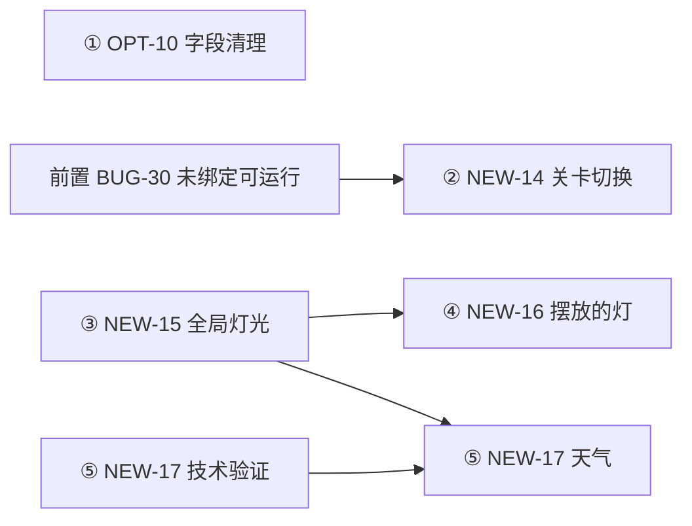

# OntoTwin 场景演出：关卡切换 · 环境灯光 · 摆放的灯 · 天气（PRD）

> 状态：需求已和产品逐项确认（2026-11-23 至 11-26 的 grill 讨论），**未开发**。
> 编号：OPT-10、NEW-14、NEW-15、NEW-16、NEW-17；前置缺陷 BUG-30。每条开工时按 AGENTS.md 登记台账、建 `.worktrees/<编号>` 草稿。
> 最终目标：非开发人员通过 OntoTwin 网页 + UE 运行时，自己搭建场景、赋予功能。
> 总原则：**尽量改造现有功能，少引入新概念。** 这一轮新增给使用者的概念只有"环境"和"摆放的灯"两个。

---

## 0. 总览

### 0.1 编号与顺序

| 序号 | 编号 | 名称 | 一句话 | 依赖 | 主要改动位置 |
|---|---|---|---|---|---|
| ① | **OPT-10** | 三处 UE 关卡字段清理 | 区域的「UE Level」从界面隐藏；底图的「绑定的 UE 场景地图」改为自动带出；楼层表的 `ue_level` 从代码里清掉 | 无 | 前端、后台 |
| 前置 | **BUG-30** | 未绑定的关卡也能正常运行 | 关卡没绑定数据集时不再卡在加载画面，不依赖数据集的功能照常可用 | 无 | UE 插件 |
| ② | **NEW-14** | 关卡切换 | Tab 面板「空间」页签里切换关卡（换地图 = 换数据集），3 种转场，网页「关卡切换」配置页 | BUG-30 | UE 插件、后台、前端 |
| ③ | **NEW-15** | 环境 · 全局灯光 | 网页「环境」页 + Tab「环境」页签：5 个灯光方案、3 个参数 | 无 | UE 插件、后台、前端 |
| ④ | **NEW-16** | 摆放的灯 | F10 模型库「灯光」分类，在 F10 属性区和网页「环境」页里管理 | NEW-15 | UE 插件、后台、前端 |
| ⑤ | **NEW-17** | 环境 · 天气 | 先做技术验证，再做平台天气接口 + 第三方天气插件的适配插件 | 产品购买插件；挂进 NEW-15 的「环境」页 | UE 插件（含新适配插件）、后台、前端 |

推进顺序：① 和 ③ 先并行开工 → BUG-30 完成后做 ② → ③ 完成后做 ④ → ⑤ 的技术验证在产品买好插件后即可开始。



### 0.2 拆出去的相关独立任务（不在本文范围）

| 编号（预留） | 内容 | 交接说明 |
|---|---|---|
| BUG-30 | 未绑定的关卡也能正常运行（本文的前置，要求见第 2 节） | 桌面 `handoff_未绑定关卡可运行.md` |
| BUG-31 | 运行时 Tab 面板跳转区域偶尔不生效。本文把"区域跳转"定为关卡内跳到某个地方的正式方案，所以要先修稳 | 桌面 `handoff_区域跳转排查.md` |
| OPT-11 | 业务视图镜头对准不准的重新验收和校准 | 桌面 `handoff_业务视图镜头校准.md` |

### 0.3 共用的技术做法（开发必读）

- **配置存放**：全部放进每个数据集现有的 `scene_interactions`（PostgreSQL 里 `project` 表的 JSONB 列）下的新键，**不改数据库结构**。写入沿用 `scene_interaction/service.py` 中 `save_roaming` 的做法：`store.transact_expected_active` 写入并把 `scene["revision"]` 加一。每个新键都有自己的校验函数，校验要拒绝未知字段、超出范围的值、非有限数（NaN）、用布尔值冒充数字、不在选项里的值。
- **下发给 UE**：在 `scene_interaction/runtime_projection.py` 的 `build_runtime_projection` 里加上新键。UE 端由 `UTwinInteractionManagerComponent` 每秒拉一次 `/api/v2/scene-interactions/runtime`，所以网页改完约 1 秒生效，不需要新的推送通道。
- **回报**：UE 每 2 秒的心跳（POST `/api/v2/scene-interactions/runtime`）里加上"实际生效了什么"，供网页显示；网页上**只存"要求的值"，不把 UE 回报的值写回配置**。
- **后台新代码放独立模块** `01-source/backend/scene_presentation/`（含 api、service、validators、tests），不往 `app.py` 里加。
- **UE 新代码放独立目录** `OntoTwinSync/Source/OntoTwinSync/{Private,Public}/ScenePresentation/`。不依赖各项目自己的 GameInstance，跨关卡的状态用 `UGameInstanceSubsystem`。
- **运行时才按路径加载的 UE 素材**（加载画面、灯光图标、默认方案参数等）必须登记进打包清单（见行为库手册第 3 节，NEW-05 的 `GetModifyCookDelegate` 做法），否则打包时会漏带。
- **日志**：每次执行写一行，格式参照 `[OT-Presentation]`，分别用 `[OT-LevelSwitch]`、`[OT-Environment]`、`[OT-PlacedLight]`、`[OT-Weather]`。
- **平台定位**：主要目标是 **Windows + RTX 5090**（可以用 Lumen、MegaLights）。Linux + Vulkan SM5 只要求能跑，效果可以降级。
- **验收方式**：只改 UE 的部分在 5501 上看不出来，按 AGENTS.md 换成产品能看到的方式验收（打包好的 UE 程序或录屏）；网页部分用 `python 01-source/tools/publish_5501.py --task <编号>` 发布到 5501。

---

## 1. ① OPT-10 三处 UE 关卡字段清理

### 1.1 背景
现在一个数据集只能绑一张 UE 地图（`db/schema.sql` 中 `project_scene_binding` 的两条唯一约束），但网页上还有三处让人手填"UE 关卡路径"，其中一处还是硬门槛：

| 字段 | 位置 | 现状 |
|---|---|---|
| 区域「UE Level」 | `frontend/instance.html` 约 L722-737，新建/编辑区域 →「高级设置」 | 不生效。只存进数据库 `zone.ue_level`，没有任何地方读取 |
| 底图「绑定的 UE 场景地图」 | `frontend/coord_workbench.html` L531（CAD 底图）、L694（图片底图） | **生效且是硬门槛**：`spatial_assets/service.py` 约 L521 不填不让发布；`scene_interaction/routes.py` 约 L202 校验；UE 端 `TwinInteractionManagerComponent.cpp` 的 `IsRuntimeRouteForCurrentLevel`（约 L1299）要求它和当前地图路径**一字不差、大小写相同**，否则漫游路线不出现，而且不报错 |
| 楼层表 `ue_level` | `floor_profile_service.py` L111、L283，`project_store.py` L349 | 不生效。界面上没有入口，只是写一个空的默认值 |

### 1.2 要做的
1. **区域**：从「高级设置」里去掉「UE Level」输入框。数据库 `zone.ue_level`、`zone.streaming` 两列**保留**，已存的值不删，后台照常读写，只是不在界面上显示。
2. **底图**：输入框改成**只读显示**，值自动取当前数据集绑定的地图路径（`ue_scene.level_path`）。
   - 新建、保存、发布底图时，后台用绑定的地图路径自动填写 `ue_level`，不再接受前端传来的值。
   - 数据集还没绑定 UE 关卡时，发布底图提示"当前数据集尚未绑定 UE 关卡，请先绑定"，不再提示"必须填写 UE Level"。
   - 换绑到另一张地图后，已发布底图的 `ue_level` 怎么处理，沿用 NEW-06 已定的规则：换绑时加新底图，旧路线停用、待复核。本条不改这部分逻辑。
   - 后台的一致性检查（`routes.py` 约 L202）保留。
3. **楼层表**：代码里不再写入 `ue_level` 默认值。已存的数据不动。

### 1.3 验收清单
- [ ] 新建、编辑区域时看不到「UE Level」；已有区域的 `ue_level` 数据库值不变。
- [ ] 坐标工作台的底图上，「绑定的 UE 场景地图」显示为只读，内容等于当前数据集绑定的地图路径。
- [ ] 不填任何关卡路径也能发布底图；发布后在 UE 里漫游路线正常出现。
- [ ] 未绑定 UE 关卡的数据集发布底图时，给出明确提示。
- [ ] 后台全量测试通过；新增测试覆盖"自动带出、忽略前端传值、未绑定时拒绝"三种情况。

---

## 2. 前置 BUG-30 未绑定的关卡也能正常运行（要求摘要）

由另一个对话负责，这里只写 NEW-14 依赖的结果：

- 关卡没绑定数据集时，**不能**一直盖着"正在连接 OntoTwin 并等待当前项目的模型数据"的加载画面（现状见 `TwinSceneManager.cpp` BeginPlay 约 L285-297、`CheckInitialBindingStatus` 的 `unbound` 分支）。
- 不依赖数据集的功能照常可用：自由镜头、上帝视角、Tab 面板、关卡切换（NEW-14）、全局灯光的"关卡原样"（NEW-15）。F7 漫游是否可用，由 BUG-30 排查后和产品确认。
- 画面上用不挡视线的提示显示"该关卡尚未绑定数据集"。网页上绑定后自动接上（现有的定时重查保留）。
- 已绑定关卡现有的加载流程（加载进度、失败自动重试）不受影响。

---

## 3. ② NEW-14 关卡切换

### 3.1 已定的决定
| # | 决定 |
|---|---|
| D9 | 关卡切换 = 换地图 = 换数据集。参照 NEW-06 的做法，改成平台通用能力。NEW-06 本身只算项目交付，暂不进 dev |
| D12 | 入口放在 UE 运行时 Tab 面板的「空间」页签，作为最上面一级（关卡 → 楼栋 → 楼层 → 房间） |
| D14 | 可切换的关卡由美术在 UE 工程设置里勾选，并填写显示名称和预览图 |
| D15 | 未绑定数据集的关卡**允许进入**（依赖 BUG-30） |
| D16 | 启动时进入 UE 工程设定的默认地图，平台不另加启动选择页 |
| D17 | 实现 3 种转场：黑场、封面加载页、画面溶解；另外 3 种（过场视频、镜头俯冲、特效过渡）在网页上列出，显示为"待补充素材"，选不了 |
| D18、D19 | 网页上单独做「关卡切换」配置页；转场挂在**目标关卡**上，表示"进入这个关卡时用什么转场"，存在它绑定的数据集里；未绑定的关卡固定用黑场 |
| D20 | 浏览器里的 OntoTwin 网页**不**跟着 UE 切换数据集 |
| D21 | 配置页放在左侧菜单「场景交互」组，列出同一个 UE 程序里所有已绑定数据集的关卡 |
| — | 关卡内跳到某个地方：用现有的「区域 + Tab 面板跳转」（先修好 BUG-31）。本轮不做子关卡、机位 |

### 3.2 UE 工程设置（美术配置）
新增一个工程设置页「OntoTwin 关卡切换」（`UDeveloperSettings`，存在工程的 ini 里），内容是一个列表，每行包括：

| 字段 | 说明 |
|---|---|
| 地图 | 选一张地图（软引用，不会强制加载） |
| 显示名称 | 中文名，例如"标准厂房" |
| 预览图 | 一张贴图，用于封面加载页；可留空 |
| 排序 | 在下拉框里的顺序 |

列表为空时，「空间」页签里**不显示**关卡下拉框，和现在完全一样。所以没配置的已上线项目升级后看不到任何变化。

### 3.3 Tab 面板「空间」页签
```
当前位置：标准厂房 / 2楼 / 会议室
关卡    [标准厂房 ▾]        ← 新增，最上面一级
目标位置 [楼栋 ▾][楼层 ▾][房间 ▾]
                     [前往位置]
```
- 下拉框每一项显示：显示名称 + 绑定状态（"数据集：xx" / "未绑定"）。绑定状态在打开下拉框时向后台查询：沿用 `/api/v2/ue/binding_status`，请求头带目标地图的场景编号，后台返回 `mode`（`matched` / `unbound`）、`project_name`，并新增 `level_switch`（目标关卡的进场转场配置）。
- **场景编号**：现在由 `EnsureSceneId`（`TwinSceneManager.cpp` 约 L223）取地图包路径。NEW-06 的标准工程用了自定义场景编号（`standard.factory` 等），开发时要处理"关卡里手动指定了场景编号"的情况：查询目标地图时，必须用它真正上报的那个编号。

### 3.4 切换流程（产品已确认）
1. 在下拉框里选一个别的关卡 → 弹出确认框："切换到『xx』会重新加载场景，需要几秒钟。"[切换] [取消]。
2. F10 有没保存的修改 → 确认框改为 [保存后切换] [放弃修改并切换] [继续编辑]；正在保存时提示"正在保存，请稍后切换"（照搬 NEW-06 `StandardSceneGameInstance.cpp` 的 `Enter`、`WaitForSave` 逻辑，用 `ATwinSceneManager` 现有的 `IsRuntimeEditDirty`、`IsRuntimeEditSaving`、`SaveAndExitRuntimeEdit`、`DiscardAndExitRuntimeEdit`）。
3. 正在 F7 漫游 → 先 `ExitRoaming()`。
4. 按目标关卡配置的转场执行（见 3.5），然后 `UGameplayStatics::OpenLevel`。
5. 新地图加载完 → 接上现有的设备加载画面（显示进度）。
6. 失败（地图不存在、没打包进程序）→ 留在原关卡，提示"无法进入『xx』"，写日志。
7. 选的就是当前关卡 → 什么都不做。

### 3.5 转场
| 方式 | 效果 | 参数 | 实现要点（开发验证） |
|---|---|---|---|
| 黑场 | 渐暗 → 黑屏加载 → 新关卡渐亮 | 时长 0.2–3 秒，默认 0.5 | 渐暗用 `PlayerCameraManager::StartCameraFade`；新地图开始时反向渐亮。已有现成用法：`TwinInteractionManagerComponent.cpp` 约 L2364 |
| 封面加载页 | 渐暗 → 全屏显示目标关卡的预览图 + 名称（+ 进度条）→ 渐亮 | 时长；是否显示进度条 | 换地图期间游戏线程被占住，要用 MoviePlayer 加载画面（`GetMoviePlayer()->SetupLoadingScreen`）。预览图来自 3.2 的工程设置，没配预览图时用平台默认底图。Linux 上的表现需要验证 |
| 画面溶解 | 截下旧关卡最后一帧盖在屏幕上 → 新关卡加载完后旧画面淡出 | 时长 | 截图存在 `UGameInstanceSubsystem` 里跨关卡保留；加载期间用 MoviePlayer 显示这张截图，新地图开始后用一个覆盖层淡出。**这是三种里技术风险最高的，开发第一步先做可行性验证** |
| 过场视频 / 镜头俯冲 / 特效过渡 | — | — | 网页上列出、显示为灰色"待补充素材"。UE 端的转场做成可扩展的注册表，以后加新方式不用改架构 |

所有转场都遵守现有的"减少动态"设置（`FOntoTwinGlassRenderer::ShouldReduceMotion` 为真时，时长按 0 处理）。

### 3.6 网页「关卡切换」配置页
- 菜单：`nexus.html`「场景交互」组新增「关卡切换」，排在「人物漫游」前面；页面放在 `interaction.html?feature=levels`（沿用现有 feature 分页方式）。
- 内容：列出**当前数据集所绑定的 UE 程序**里所有已绑定数据集的关卡。
```
关卡切换配置 · UE 程序：OntoTwinStandardScenes
关卡        绑定的数据集        进入时的转场        时长   进度条
标准厂房 ★   标准厂房示例        [封面加载页 ▾]     1.0s   [开]
展示空间     展厅示例           [画面溶解 ▾]       1.5s
空白场地     某某（无权限）      画面溶解（只读）
[应用到全部]                                        [保存]
未绑定数据集的关卡进入时固定使用黑场，不在此列出。
```
- 权限：用户有权编辑的数据集才能改；没权限的行只读；"应用到全部"只作用于可编辑的行。各组织的数据隔离不能被打破：其他组织的数据集**不显示**。
- 存放：每个数据集 `scene_interactions.level_switch = {transition: {mode, duration_s, show_progress}}`。`mode` 可选 `fade` / `cover` / `dissolve`；`video` / `camera_dive` / `fx` 保留，校验时拒绝。
- 后台接口（在 `scene_presentation/` 模块里）：GET 返回同一 UE 程序的关卡列表及每行的可编辑性；PUT 分行保存，每行按各自数据集的 revision 做并发检查。

### 3.7 验收清单
- [ ] 工程设置里配 3 张地图，「空间」页签出现关卡下拉框，显示名称和绑定状态正确；不配时不出现，界面和现在完全一样。
- [ ] 三种转场各切换一次，效果和网页上的配置一致；修改网页配置后，下一次切换立刻按新配置执行。
- [ ] F10 有未保存修改时，三个按钮的行为都正确；漫游中切换会先退出漫游。
- [ ] 进入未绑定的关卡：不卡加载画面，有"尚未绑定"提示（依赖 BUG-30）；在网页上绑定后自动接上。
- [ ] 同一个程序里，在 A、B、C 之间往返切换 9 次，每次设备都正确（对齐标准工程 PRD 的 AC-07）。
- [ ] 进入一个不存在或没打包的地图：留在原关卡，有提示。
- [ ] 网页配置页：权限、只读、"应用到全部"、组织隔离都正确；后台测试覆盖校验和并发冲突。
- [ ] 不装天气插件的工程里也全部通过。

---

## 4. ③ NEW-15 环境 · 全局灯光

### 4.1 已定的决定
| # | 决定 |
|---|---|
| D3 | 灯光是**全局**能力，和业务视图无关 |
| D4（修订） | 方案 = **关卡原样**（美术调的那一套，默认）+ 平台自带 4 个：白天、黄昏、夜晚、展示。美术只调一套，不存在"追加多套方案" |
| D22 | 网页上设定，UE 实时生效；UE 里可以临时切换，**不保存**（重启或网页上一改就回到网页设定的值） |
| D23 | 3 个参数：整体亮度（-2 到 +2，0 为原样）、色温（偏冷 ↔ 偏暖）、阴影开关。故意不开放：太阳角度、时间、雾浓度、天空颜色 |
| D24 | 接管关卡原有的环境光（太阳、天光、雾、曝光），在它们的参数上修改；关卡原样随时能切回，原值不丢 |
| D28 | UE 端在 Tab 面板新增「环境」页签（全局灯光 + 天气）；网页上的页面叫「环境」 |
| — | 灯光方案不含"阴天"（天气里有"阴"） |
| — | 没有时间概念：系统不看真实时钟，"夜晚"只是当前选中的方案名。跟随真实时间属于路线图 |

### 4.2 UE 端
- 新组件 `UOntoTwinEnvironmentComponent`（挂在 `ATwinSceneManager` 上）：
  - **BeginPlay 时记录"关卡原样"**：找到关卡里的主太阳（`ADirectionalLight`，优先找作为大气太阳的那一盏）、`ASkyLight`、`AExponentialHeightFog`、全局（无边界）的 `APostProcessVolume`，把相关参数存为原样快照。缺哪个就跳过哪个。
  - 切到某个方案：按平台方案的参数改这些对象；切回"关卡原样"：恢复快照。
  - 3 个参数在任何方案上（包括关卡原样）叠加：整体亮度 → 曝光补偿；色温 → 太阳和天光的色温；阴影 → 太阳的投射阴影开关。
  - **烘焙灯识别**：主太阳的可移动性为静态（Static）时，回报"灯光为烘焙，部分效果不生效"。
  - 改动只作用于自己接管的对象，退出或换关卡时不需要额外清理。
- 平台 4 个方案的参数放在插件里的一个数据资源（Data Asset），需要登记进打包清单。参数由技术美术在开发阶段调好，产品看效果后确认。
- **Tab 面板「环境」页签**：`OntoTwinRuntimeDockWidget` 新增第四个页签「环境」：
```
灯光方案  ( ) 关卡原样  ( ) 白天  ( ) 黄昏  (●) 夜晚  ( ) 展示
          临时：夜晚（网页设定为：关卡原样） [恢复网页设定]
天气      ……（NEW-17）
```
  - 只能切方案，不能调参数。
  - 临时切换只在本次运行有效；网页上的设定一变，临时状态立即作废，回到网页的值。
- 心跳回报：当前生效的方案、是否处于临时状态、是否检测到烘焙灯。

### 4.3 网页「环境」页
- 菜单：「场景交互」组新增「环境」，紧挨着「关卡切换」；页面 `interaction.html?feature=environment`。
- 上半部分是全局灯光：方案下拉框、3 个参数、烘焙提示、"UE 当前生效：xx（临时）"。下半部分是摆放的灯（NEW-16），之后是天气（NEW-17）。
- 存放：`scene_interactions.environment.lighting = {preset, exposure_bias, color_temperature, shadows}`。`preset` 可选 `level_default` / `day` / `dusk` / `night` / `showcase`。

### 4.4 验收清单
- [ ] 已上线项目升级后画面不变（默认关卡原样，参数为 0）。
- [ ] 5 个方案逐个切换，约 1 秒内在 UE 里生效；切回关卡原样后和升级前截图一致。
- [ ] 3 个参数在每个方案上都起作用。
- [ ] Tab「环境」页签临时切换后，提示和[恢复网页设定]正确；网页上一改，临时状态作废；重启后回到网页的值。
- [ ] 主太阳为烘焙灯的关卡，网页上显示提示，切换方案不报错。
- [ ] 关卡里缺雾或缺天光时，其余部分照常生效。
- [ ] 未绑定的关卡里，「环境」页签可用，至少能保持关卡原样（依赖 BUG-30）。

---

## 5. ④ NEW-16 摆放的灯

### 5.1 已定的决定
| # | 决定 |
|---|---|
| D25 | 放进 F10 模型库，作为"灯光"分类，摆法和模型一样（拖入、移动、旋转、撤销、删除恢复）。3 种：点光源、射灯、面光源 |
| D26 | 归属房间：先在 Tab「空间」页签进入某个房间再按 F10 摆灯，默认归到这个房间；否则归到"未分配"。F10 属性区和网页上都能改。**区域没有空间范围**，所以不按位置自动判断 |
| D27 | 网页「环境」页里按房间分组管理：开关、亮度、颜色（预设下拉）、改名、改房间、本组/全部开关；不能在网页上删除或新增灯；灯和方案之间不做联动 |
| D28 | UE 里在 F10 属性区管理灯；Tab 面板里没有灯的开关 |
| D30 | 默认上限：每个关卡 64 盏灯，其中 16 盏可投射阴影；网页上可调，范围由技术验证确定 |
| — | 在 Tab 面板里进入某个房间、隐藏别的房间的设备时，**灯不受影响** |

### 5.2 数据
- 灯和 F10 摆的模型一样，是一个**布景实例**（`object_type_rid = ontotwin.scene_object`，见 `runtime_placement.py`）。区别在于模型库条目是平台内置的灯光键（例如 `ot.light.point`、`ot.light.spot`、`ot.light.rect`），不是 UE 模型路径。`runtime_placement.py` 里按 `ue_asset_path` 识别模型的逻辑要相应扩展。
- 灯的参数存在实例的 `render_config.light` 下：

| 字段 | 点光源 | 射灯 | 面光源 | 说明 |
|---|---|---|---|---|
| `enabled` | ✓ | ✓ | ✓ | 开关 |
| `intensity_lm` | ✓ | ✓ | ✓ | 亮度，单位流明；界面提示"普通吸顶灯约 800" |
| `color` | ✓ | ✓ | ✓ | 预设：暖白、白、冷白、红、绿、蓝、黄 |
| `radius_cm` | ✓ | ✓ | ✓ | 照射范围 |
| `cone_deg` | | ✓ | | 光束角度 |
| `width_cm`、`height_cm` | | | ✓ | 发光面大小 |
| `cast_shadows` | ✓ | ✓ | ✓ | 默认关 |

- 所属房间用实例现有的 `zone_id`（只能是最底层的区域，沿用 `validate_zone_hierarchy` 的规则）。"未分配" = 空。
- 上限存在 `scene_interactions.environment.placed_light_limits = {max_lights, max_shadowed}`。
- 业务视图本来就排除布景（`web_interaction/validators.py` L196），灯不会进业务视图，这一点不变。

### 5.3 UE 端
- F10 模型库新增"灯光"分类，3 个条目，缩略图用平台内置图标。
- 灯在运行时生成为可移动灯（Movable）。编辑模式（F10）下显示灯泡图标，方便选中；运行时只有光，不显示图标。
- F10 属性区：选中灯时显示 5.2 表里的参数和所属房间。
- 达到上限时，F10 提示"已达上限（64 / 64）"，不能再放；打开阴影的灯达到上限时，阴影开关变灰。
- 区域显隐（`ApplySceneScope`）跳过灯光布景。
- 网页修改灯的参数后，通过现有的快照或增量通道（灯是实例）约 1 秒内生效。

### 5.4 网页（「环境」页下半部分）
```
摆放的灯（12）  已用 12 / 64 盏，阴影 2 / 16 盏        [全部开] [全部关]
▾ 2楼 / 会议室（4）                                  [本组开] [本组关]
   💡 吸顶灯-1   点光源  [开]  亮度 [800]  颜色 [暖白 ▾]  房间 [会议室 ▾]
   🔦 射灯-展台   射灯    [关]  亮度 [1200] 颜色 [白 ▾]
▾ 未分配（2）
修改后约 1 秒内在 UE 里生效。删除灯请到 UE 的 F10。
```

### 5.5 验收清单
- [ ] F10 里 3 种灯都能拖入、移动、旋转、撤销、删除，删除后能从回收站恢复。
- [ ] 进入某个房间后摆灯，默认归到该房间；直接摆灯归到"未分配"；两边都能改房间。
- [ ] F10 属性区和网页上改参数，两边显示一致，约 1 秒生效。
- [ ] 网页本组/全部开关正确；没有删除、新增入口。
- [ ] 上限：达到 64 盏、16 盏阴影时的提示和限制正确；网页上改了上限后立即生效。
- [ ] 切换房间时，别的房间的灯不跟着隐藏。
- [ ] 夜晚方案下，房间里的灯能正常照亮房间（Lumen 下的观感由产品确认）。
- [ ] 性能：在 Windows + 5090 上，64 盏灯（其中 16 盏开阴影）时帧率达标（标准在技术验证时和产品一起定）。

---

## 6. ⑤ NEW-17 环境 · 天气

### 6.1 已定的决定
| # | 决定 |
|---|---|
| E1 | 晴、阴、雾、雨、雪，每种有小、中、大三档强度；雨雪跟着镜头下，头顶有遮挡的地方不下；阴、雨、雪自动压暗阳光（叠加在灯光方案上）。**不做**积水、积雪、雷电、风、声音 |
| D29 | 平台只定义**天气接口**；第三方天气插件通过**单独的适配插件**接入。**工程里没装天气插件时，其他所有功能照常运行**，天气选项显示灰色"本工程未安装天气插件" |
| — | 候选插件：Ultra Dynamic Sky / Ultra Dynamic Weather **9.x 官方英文版**（Fab）。不用第三方翻译的"中文版"，也不用 8.x。授权和购买由产品负责 |
| — | 设置方式和全局灯光一样：网页设定，Tab「环境」页签临时切换、不保存 |

### 6.2 第一步：技术验证（产品买好插件后开始，1–2 天）
要回答的问题，结论写进本节后再开发：
1. UDW 能不能脱离 UDS 的天空和太阳单独使用，**保留关卡原样的灯光**（D24）？如果不能，有什么折中办法？
2. 室内遮挡：雨雪不进房间的效果；需要美术在每个房间摆遮挡体积的工作量。
3. 在 Windows + 5090 上的帧率；Linux 能不能跑。
4. 阴、雨、雪压暗阳光的方式，能不能和 NEW-15 的方案、参数叠加而不打架。

### 6.3 结构
- 平台插件 `OntoTwinSync` 里定义接口 `IOntoTwinWeatherProvider`（UE 的模块化功能 Modular Feature，参照现有的 `IOntoTwinPresentationExecutor`）：`Apply(type, intensity)`、`IsAvailable()`。
- 适配插件 `OntoTwinWeather_UDS`（独立插件，依赖 UDS/UDW）实现这个接口。平台插件**不依赖**任何第三方天气插件。
- 心跳回报 `weather_available`；为假时，网页和 Tab 面板的天气选项显示灰色。
- 存放：`scene_interactions.environment.weather = {type, intensity}`。`type` 可选 `clear` / `overcast` / `fog` / `rain` / `snow`，`intensity` 可选 `light` / `medium` / `heavy`。

### 6.4 验收清单
- [ ] **没装适配插件的工程**：关卡切换、全局灯光、摆放的灯全部正常，天气显示灰色，日志里没有报错。
- [ ] 装了的工程：5 种天气 × 3 档强度逐个切换，约 1 秒生效；室内不下雨雪。
- [ ] 天气和灯光方案叠加后，切回"晴 + 关卡原样"，画面和升级前一致。
- [ ] Tab「环境」页签的临时切换规则和灯光一致。
- [ ] 性能达标（标准在技术验证时定）。

---

## 7. 路线图（不在本轮）

| 项 | 说明 |
|---|---|
| 业务数据触发 | 例如设备告警时自动定位到该设备并切到告警氛围，解除后恢复 |
| 定时触发 / 跟随真实时间 | 例如每天 18:00 自动切到夜晚；届时给灯光加"时间"参数，并考虑"方案切换时联动一组灯" |
| 大屏轮播 | 按顺序轮流切换业务视图或区域 |
| 机位、关卡内转场 | 存镜头书签；关卡内跳转时用淡入淡出或飞行过渡（可以和 OPT-11 业务视图镜头校准的方案 B 合并设计） |
| 子关卡加载 | 一张大地图一次加载不下时，再按区块加载 |
| 过场视频 / 镜头俯冲 / 特效过渡 | 已在网页上列出，等素材补充 |
| 网页提示"UE 当前在哪个关卡" | 需要先有"一个人对应一台 UE"的认领机制 |
| 给房间画范围 | 在底图上给区域画范围，实例和灯按位置自动归属房间，顺带补齐历史实例的房间归属 |
| 天气增强 | 积水、积雪、雷电、风、声音 |
| 画面风格、设备之间的连线特效、声音、组合画面 | 等真实需求出现再考虑 |

## 8. 风险

| 风险 | 影响 | 应对 |
|---|---|---|
| UE 工程内容（地图）不在代码库里，看不到各项目的灯光是怎么搭的 | 关卡原样的识别、烘焙灯的比例都不确定 | NEW-15 开发初期逐个项目核对 |
| 画面溶解需要跨关卡保留截图 | 可能做不到 | NEW-14 第一步先验证；做不到就和产品商量降级为封面加载页 |
| MoviePlayer 加载画面在 Linux 上的表现 | 封面加载页、画面溶解在 Linux 上可能降级 | Linux 只要求能跑，可降级为黑场 |
| UDW 单独使用可能做不到 | 天气会改动关卡原样的灯光 | NEW-17 技术验证先回答 |
| NEW-06 标准工程里有一套自己的关卡切换面板（`StandardSceneGameInstance`） | 将来和 NEW-14 同时出现会有两个入口 | NEW-06 进 dev 前，改为使用平台的关卡切换 |
| 多个 AI 同时修改 Tab 面板（`OntoTwinRuntimeDockWidget`） | 合并冲突 | NEW-14（空间页签）和 NEW-15（环境页签）按 AGENTS.md "调整自己的去适应先发布的那一条" |

## 9. 名词解释

- **关卡 / 地图**：UE 里的一个场景文件。本文里"切换关卡"就是换一张地图。
- **数据集**：OntoTwin 网页上的一个项目，包含设备、业务、配置等。现在一张地图只能绑一个数据集。
- **Tab 面板**：UE 运行时按 Tab 键打开的控制面板（运行 Dock），有「空间 / 业务 / 漫游」页签，本文新增「环境」页签。
- **F10**：UE 运行时的场景编辑模式，可以摆放模型，本文新增摆放灯。
- **布景**：F10 摆进场景的东西，在后台是一个有编号的实例，但不属于任何业务类型。
- **烘焙灯**：光影提前算好"画"在模型上的灯，运行时改不了。
- **Lumen / MegaLights**：UE 5 的实时全局光照和大量灯光技术，让灯光改变后画面自然变化。
- **转场**：从一个画面过渡到另一个画面的效果。
- **技术验证**：正式开发前，用一两天做最小的试验，确认关键技术能不能行得通。
